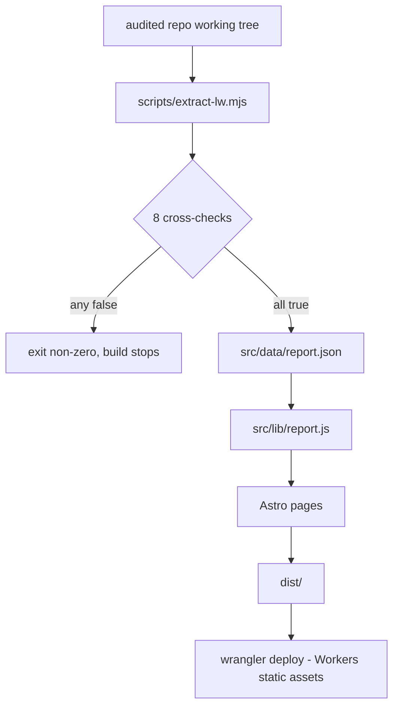

# PROCESS.md

How this site is built, and what has to be true before a change ships.

## The one rule

Every number on the site comes from a file in the audited repository, through
`scripts/extract-lw.mjs`. Nothing is typed by hand into a page or a component. If a figure
cannot be read from a source file, it does not appear.

## Pipeline



`npm run verify` re-extracts into `.cache/report.verify.json` and diffs it against the
committed `src/data/report.json`, ignoring only the timestamp. It fails on drift, so a
stale committed figure cannot pass CI.

## The checks

The extractor refuses to write its output if any of these is false:

| check | what it catches |
|---|---|
| README counter block vs `tools/constructs.json` | the two tallies drifting apart |
| audit table vs `tools/constructs.json`, row by row, verdict included | an audit row added without a construct row, the reverse, or a construct reclassified on one side only |
| audit table vs `tools/constructs.json`, batch per row | a construct proven in a different batch on one side |
| facade census complete | a facade in the source that the audit never classified |
| MAP coverage index has no blank verdict | a documentation page silently dropped |
| MAP tally line vs the classes parsed from its own table | the table and the summary printed next to it drifting apart |
| README docs counter vs MAP row count | the same, from the other direction |
| the ledger table is read whole (G.3 section scan) | a blank line inside the ledger table truncating it. This is not hypothetical: the table is interrupted by one blank line, and the parser used to publish 15 of its 19 rows |
| every ledger status is a known token (OPEN / DONE / TOLAK) | a shifted column making a status unreadable or invented |
| one feature-map row per area | a feature area that lost its rows in parsing |
| the feature map is read whole (MAP §5, counted line by line) | the same truncation class, in the section with seven tables |
| the severity bands are defined in the source | this report paraphrasing what P1/P2/P3 mean and presenting the paraphrase as the project's |
| the verdict badge and the CI comment heading are both read from README | a typed-in verdict surviving a change to either string |
| every CPU figure the /coverage/ table prints is still a phrase in `COMPILED.md` | the one hand-shaped table drifting away from the file its caption names |
| the audit scratchpad row count is quoted from the source | the severity spread losing the denominator it came from |

The first two construct checks are per-row rather than tally-based on purpose: tallies
can agree while two rows are swapped. The audit table's own build column and per-row batch
are compared and then dropped from `report.json`, since no page renders the audit table —
the construct's own `verdict` and `batch` are the published fields. That is worth about
9 KB of the payload and one fewer field to keep in sync.

## What is deliberately not published

`notes/PLAYBOOK.local.md` is gitignored in the audited repository: it is working-tree
material, not published text. This site therefore republishes only its aggregate shape
(row count, status tally, severity spread, area counts) and never its item text. The
`/ledger/` page states this in the reader's face rather than burying it.

`.opencode/context.md` is gitignored as well (`.gitignore` line 9), and it is read for one
thing: the definition of the P1/P2/P3 severity bands, which is quoted verbatim rather than
paraphrased, because a paraphrase would be this report's claim about the project's
severity model. The `/method/` file table marks both notes as untracked, and the
`tracked` flag on each entry of `auditedRepo.files` is read from `git ls-files`.

## Local development

```sh
npm install
npm run extract    # refresh src/data/report.json from ../laravel-workers
npm run dev        # http://localhost:4321
npm run build      # static build into dist/
npm run preview    # build, then wrangler dev (Worker + assets, real 404 path)
```

## Release

```sh
npm run deploy     # extract -> verify -> astro build -> wrangler deploy
```

The deploy runs the extraction and the drift check first, so a stale or unverified figure
cannot reach the public URL. After deploying, load the root and one bad deep link: the
first must render, the second must return the styled 404 page rather than a bare browser
error.

## Verification recorded for the current revision

All of it in Chromium, against the built output, both themes.

| what | how | result |
|---|---|---|
| every page renders | 8 routes fetched and inspected | 8/8 |
| text contrast | computed colour pairs, WCAG contrast with alpha compositing | min 4.19:1 for large status text, 5.52:1 for 13px muted text |
| non-text contrast | census cells, dots, chips, buttons vs their ground | min 4.61:1, all above the 3:1 floor |
| horizontal overflow | 320, 360, 480, 600, 768, 1024, 1440 px, all routes | none |
| tap targets | interactive elements measured at 360 px | 24 px cells on coarse pointers; only inline links in prose are smaller, which WCAG 2.5.8 exempts |
| census grid interaction | chip filter, cell click, arrow keys, Enter | 118 rows to 64 and back, panel fills, focus moves |
| theme | pre-paint script plus toggle, both themes | theme is applied by an inline script before first paint; toggle swaps both palettes |
| keyboard reachability | repeated Tab from the document start | skip link, brand, nav, toggle, main content, footer |
| oversized tables | wide tables inside a scroll container | container is keyboard-focusable; page itself never scrolls sideways |

## Limits stated on the site

The `/method/` page is the public version of this list: which commit was read, what was
measured on what machine, that one-run CPU numbers are not a benchmark, that punctuation
inside quoted rows from the audited repo was normalised, and that the ledger's item text
is withheld.
